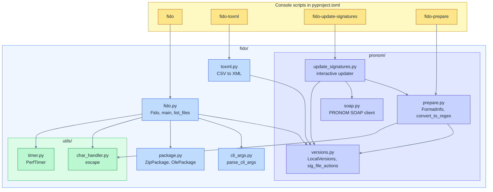
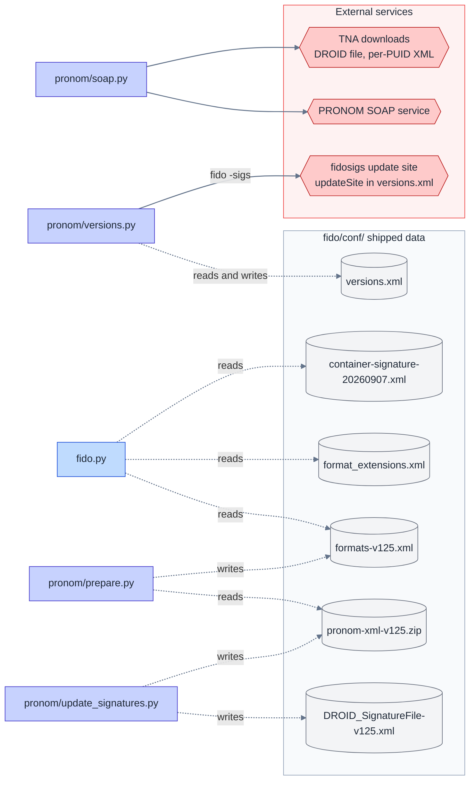
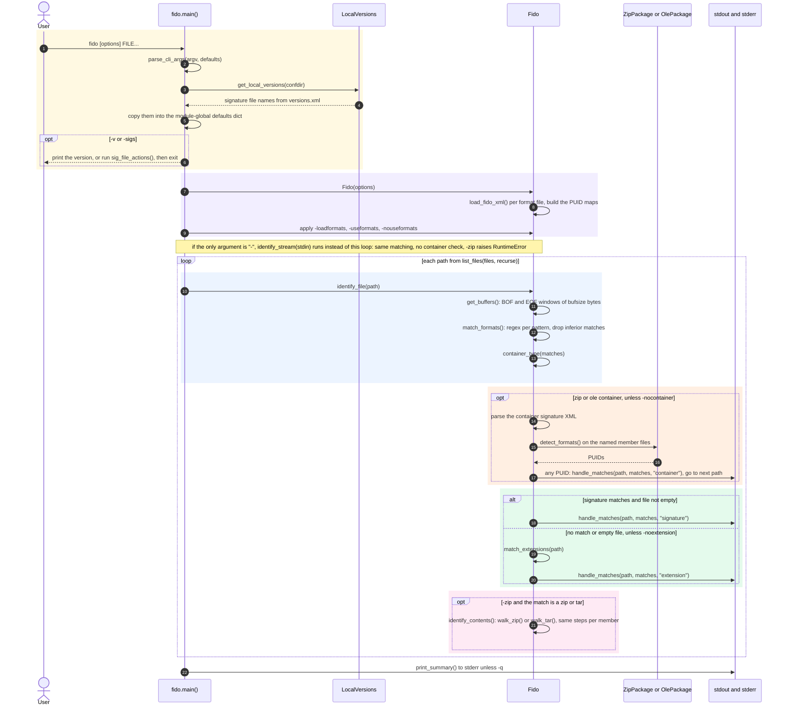
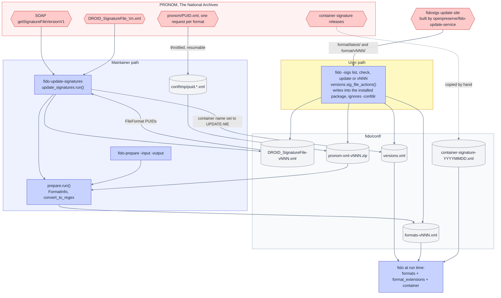
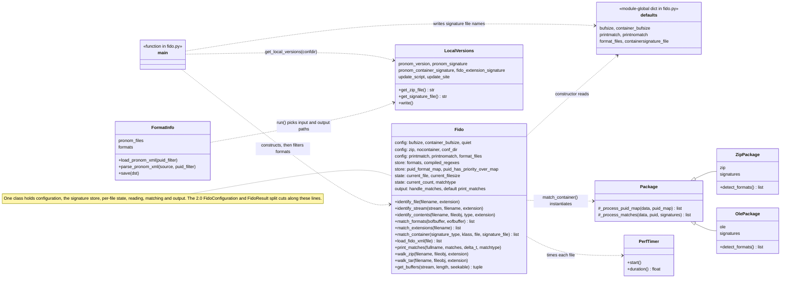
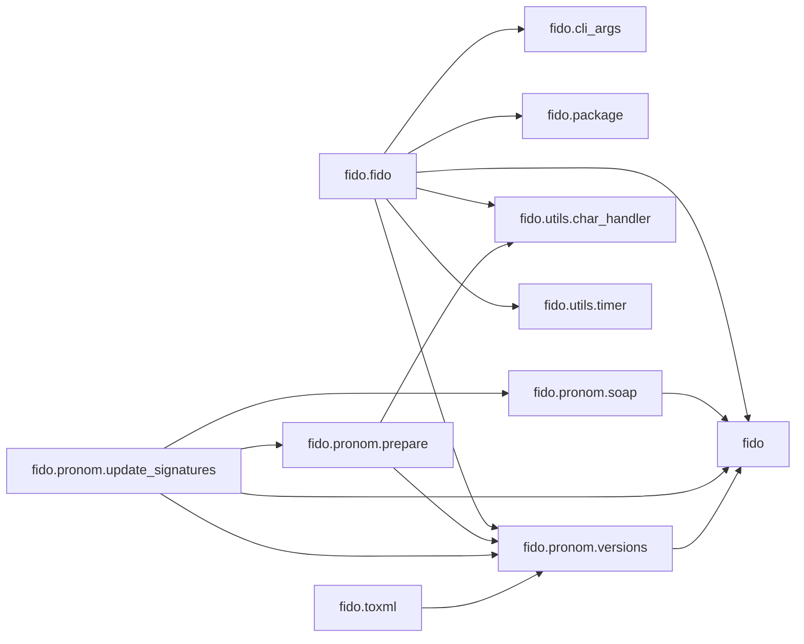

# FIDO architecture map

Drawn from the code at `959c7d3` (branch `dev/issue-244-stdin-bytes`, PR #246 head, based on upstream main `a7c8fa2`) on 2026-11-23.
Diagrams 1a to 4 are drawn by hand from reading the code. Diagram 5 is generated by pyreverse as a cross-check. Section 6 is a dated table of open upstream PRs.

## 1a. Commands and modules



Arrows are imports. `fido/__init__.py` (`__version__`, `CONFIG_DIR`) is imported by `fido.py`, `soap.py`, `update_signatures.py` and `versions.py` and is left out to keep the picture readable.

## 1b. Files and services each module touches



Dotted arrows are file reads and writes, solid arrows are network calls.

## 2. `fido FILE...`: identifying files



How to read the boxes (UML calls them combined fragments). The text in `[brackets]` is the condition.

- `loop`: runs once per item.
- `alt` with `else`: if/else. Exactly one section runs, the sections are split by a dashed line.
- `opt`: if without else. The contents run only when the condition holds.

Colour bands: yellow is start-up, purple loads the signatures, blue reads and matches one file, orange is the container check, green prints the result, pink recurses into zip and tar members.

With `-noextension` and no signature match, neither `alt` section runs and no row is printed (issue #266). `handle_matches` defaults to `print_matches`, which fills the `-matchprintf` and `-nomatchprintf` CSV templates.

## 3. Where the signature files come from



## 4. Classes



## 5. Generated cross-check: module imports (pyreverse)



Regenerate it with pylint's pyreverse:

```sh
pyreverse -o dot -p fido -d /tmp/pyreverse fido
rg -o '"[a-z_.]+" -> "[a-z_.]+"' /tmp/pyreverse/packages_fido.dot \
  | awk -F'"' '{a=$2; b=$4; ia=a; ib=b; gsub(/\./,"_",ia); gsub(/\./,"_",ib); printf "  %s[\"%s\"] --> %s[\"%s\"]\n", ia, a, ib, b}'
```

Use the dot output: pyreverse's own `-o mmd` gives the package `fido` and the module `fido.fido` the same name, so it draws `fido --> fido`.
It agrees with diagram 1a. The only extra edges are the imports of `fido/__init__.py`.

## 6. Open upstream PRs and the modules they touch

Snapshot 2026-11-23

| PR | fido.py | cli_args.py | pronom/versions.py | pronom/prepare.py | pronom/soap.py, pronom/\_\_init\_\_.py | utils/char_handler.py | pyproject.toml | CI and CONTRIBUTING | README, docs/index.md |
|---|:-:|:-:|:-:|:-:|:-:|:-:|:-:|:-:|:-:|
| #246 fix(cli): stdin as bytes | ● | ● | | | | | | | ● |
| #247 fix(cli): printf, bufsize, missing paths | ● | ● | | | | ● | | | ● |
| #253 chore(ci): PR checks, lint | ● | | | | | | ● | ● | |
| #254 fix(fido): non-UTF-8 names, match errors | ● | | | | | | | | ● |
| #255 fix(pronom): HTTP timeouts | | | ● | ● | ● | | | | |
| #256 chore(deps): requests floor | | | | | | | ● | | |
| #257 fix(pronom): -confdir for -sigs | ● | ● | ● | | | | | | ● |
| #259 fix(pronom): http(s) reference URLs | | | | ● | | | | | |
| #149 importable fido (2.0 refactor input) | ● | | | | | | | | |
| **Open PRs touching it** | **6** | **3** | **2** | **2** | **1** | **1** | **2** | **1** | **4** |

